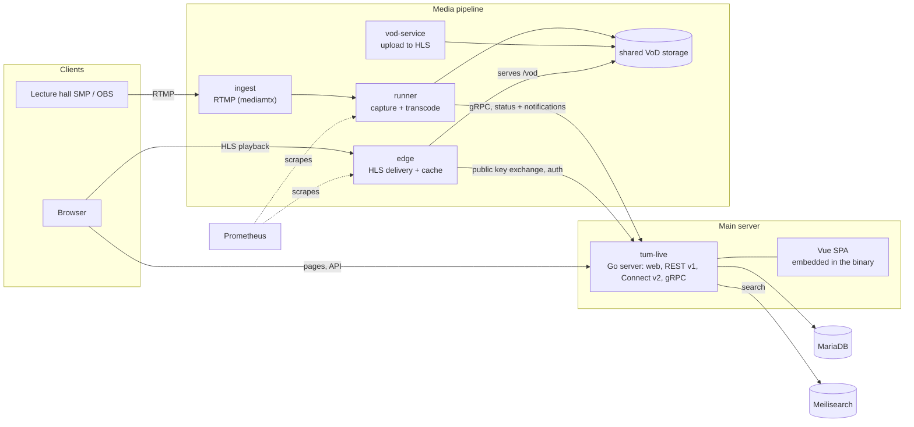

# Architecture

GoCast is a Go monolith (`tum-live`) that serves the web app and API, surrounded by
services that capture, transcode and deliver video.

## Components

| Component | Role |
|---|---|
| `tum-live` | Web app, REST v1 (`api/`), Protobuf/Connect v2 (`apiv2/`), gRPC endpoint for runners. Owns the database. |
| `frontend/` + `web/` | The Vue SPA (`frontend/`), embedded into the binary from `web/spa/`. `spaRoutes` in `web/router.go` lists the paths Go answers with the SPA shell. |
| `ingest` | Receives RTMP streams from lecture hall SMPs and self-streamers. |
| `runner` | Captures streams, transcodes them to HLS and creates VoDs, including from uploaded files. Replaces the older `worker`. |
| `vod-service` | Packages the files the legacy `worker` pushes after recording to HLS without re-encoding. Uploads through the web UI no longer use it. |
| `edge` | Serves HLS and VoD files to viewers, validates stream tokens against `tum-live`. |
| MariaDB / Meilisearch | Persistence and full-text search. Search is optional locally. |

The diagram follows `docker-compose.yml`, which is for local development only; production
deployments split these across hosts (see [Deployment](../selfhosting/deploy.md)).
