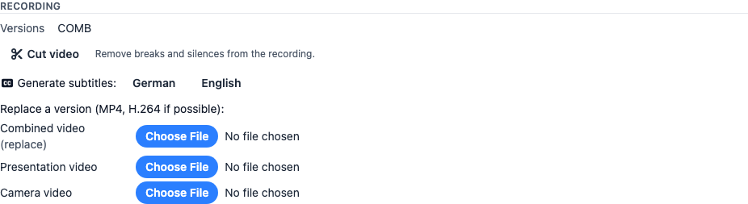
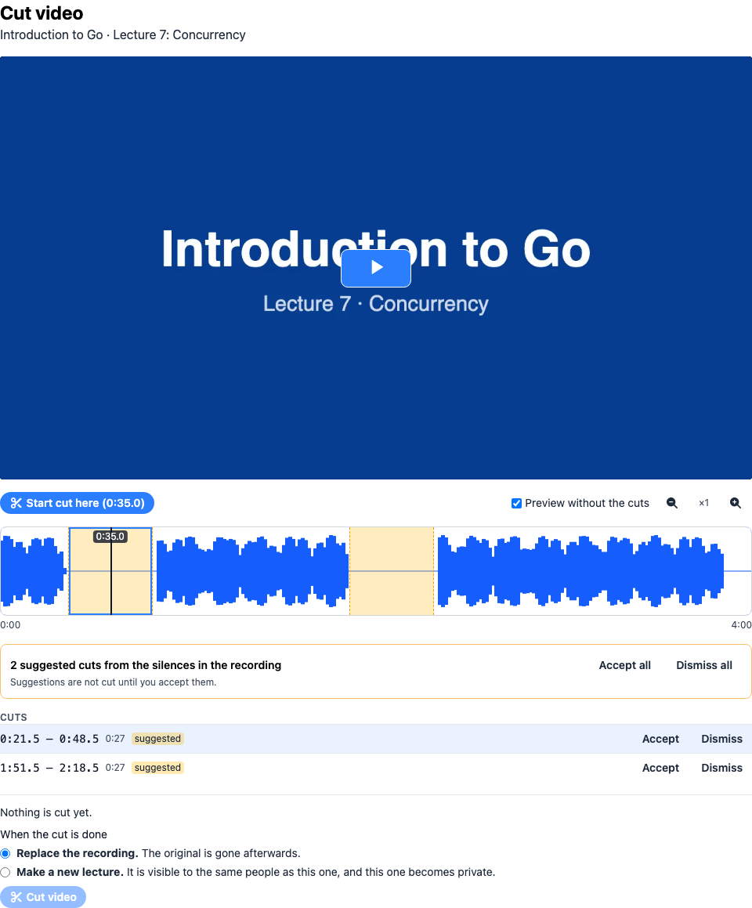
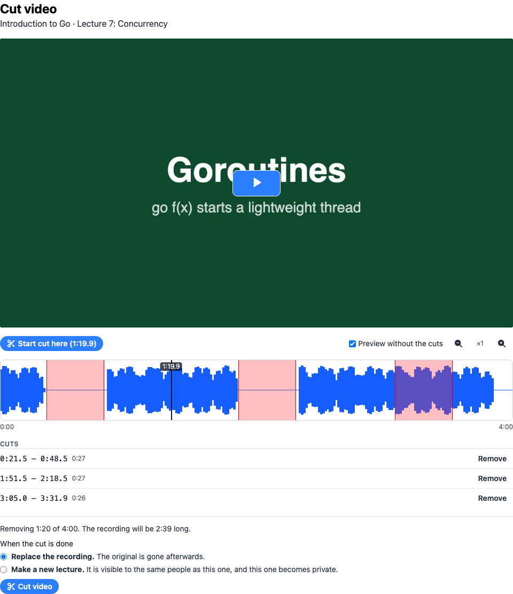
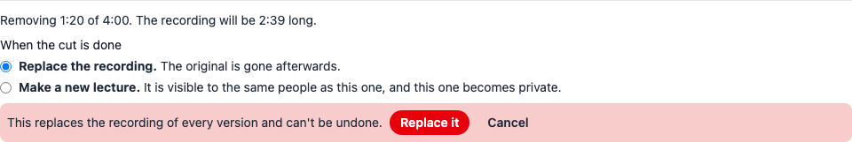
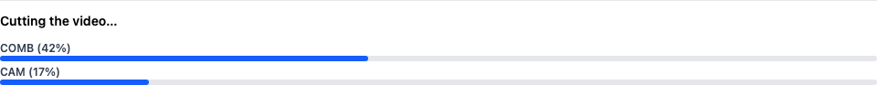

# Cut a recording

Course administrators can remove parts of a recorded lecture, for example a break, a
technical problem or the minutes before the lecture starts. You mark the parts to remove
in the browser. A runner then re-encodes the recording without them, either replacing the
recording or making a new lecture of the result.

A lecture can be cut once it has a finished recording and is not live.

## Open the editor

On the Admin page's sidebar, navigate to:

`Courses > 'Term' > 'Your Course' - Lectures`

Open the lecture with **Edit**. The **Recording** section has a **Cut video** button.

The lecturer controls under the player on the lecture's watch page link to the editor too.

The first time you open the editor for a lecture, a runner builds the audio timeline. This
takes a minute or two for a long lecture, and the page shows **Building the audio
timeline** until it is done. The timeline is kept, so opening the editor again is quick. It
is built again after the recording changes.

## The editor

From top to bottom:

- **The player** shows the recording. It always plays the whole recording, not only the
  part a lecturer has trimmed with a start and end.
- **The timeline** shows the recording from left to right, with the loudness of the audio
  as a graph. Quiet parts are flat lines. The black line is the current position of the
  player.
- **Suggestions**, if the recording has long silences. See below.
- **The cuts** you have made, and what they leave of the recording.

## Make cuts

You can make a cut in three ways:

- **Drag** over the timeline. Dragging backwards works too.
- **Mark it while watching.** Play or seek the video to where the cut starts and click
  **Start cut here**. Then go to where it ends and click **End cut here**. The cut ends up
  on the timeline.
- **Accept a suggestion.**

To change a cut, drag one of its edges. To seek, click anywhere on the timeline. Click a
cut to select it, and press `Delete` to remove it. **Remove** next to a cut in the list
does the same.

Some more help:

- **Zoom** with the magnifier buttons, up to 16 times. A long lecture is only a few pixels
  per second wide otherwise.
- With the timeline focused, the arrow keys seek by one second, and by ten seconds with
  `Shift`.
- **Preview without the cuts** makes the player skip the cuts while it plays, so you can
  hear what the result will sound like. It does not skip when the video is paused, so you
  can still look at a cut.
- Cuts that touch or overlap become one cut. A cut must be at least half a second long, and
  at least one second of the recording has to remain.

## Suggested cuts

Silences in the recording, stretches of at least 30 seconds without sound, are proposed as
cuts. They are drawn dashed and orange and labelled **suggested**. A suggestion leaves a
second and a half of the silence at both of its ends, so that the last words before it and
the first after it are not clipped.

**Suggestions are not cut until you accept them.** Use **Accept** or **Dismiss** on a
single suggestion, or **Accept all** or **Dismiss all**. Dragging a cut over a suggestion
accepts what it covers.

## Cut the video

Below the list of cuts you see how much is removed and how long the result will be. Choose
what happens to the result:

- **Replace the recording.** The recording is replaced and the original is gone afterwards.
  The editor asks once more before it does this.
- **Make a new lecture.** The result becomes a new lecture in the same course, with the
  title, description and the other settings of the original. Once it is done it is visible
  to the same people as the original, and the original becomes private. Until then it is
  private and has no recording.

Then click **Cut video**. The page shows how far each version of the recording has got.

The recording is encoded again to cut it exactly where you marked, so this takes a while,
about as long as converting an uploaded video. You can leave the page. The lecture's card
on the lectures page shows the progress too.

When all versions are done, **Watch the cut video** opens the lecture.

## Things to know

- **All versions are cut the same.** A lecture can have a combined, a presentation and a
  camera version. You see and cut the combined one, and the same ranges are cut from the
  others. If the versions differ in length by more than 30 seconds, they cannot be cut
  together and the editor says so instead of cutting.
- **Sections and trimming move along.** The video sections of the lecture, and a start and
  end set earlier, move to where they are in the cut recording. A section that was inside
  a cut moves to where the cut was.
- **Silences are detected again** once the cut is done, so skipping silences works on the
  cut recording.
- **Subtitles are not changed.** Subtitles made before the cut no longer fit. Generate them
  again in the **Recording** section. A new lecture starts without subtitles.
- **Only one cut at a time.** The editor refuses to start a cut while a version of the
  lecture is converting, and it waits for the conversion if it is opened while one runs.
- **If a version fails**, the page and the lecture's card name it and say why. Nothing is
  replaced for a version that failed, but the other versions are cut already. Open the
  editor and cut again to try once more, and check the result of all versions when you
  replaced the recording.
