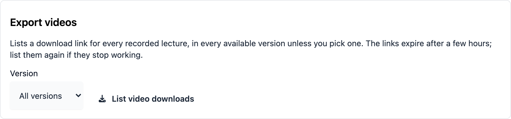
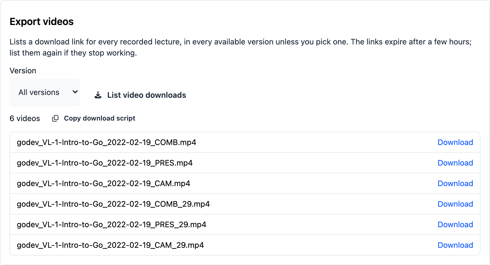

# Export all videos of a course

Course administrators can list a download link for every recorded lecture of a course
and download them one after another with a generated script. This is useful for
archiving a course or moving it somewhere else.

## List the downloads

On the Admin page's sidebar, navigate to:

`Courses > 'Term' > 'Your Course' - Settings`

At the bottom of the page you will find the **Export videos** section.



1. Pick the **Version**. **All versions** is the default and lists every version a
   lecture has (combined, presentation and camera). Pick a single version to list only
   that one.
2. Click **List video downloads**.

The list shows one file per lecture and version. The file names contain the course, the
lecture name, the date and the version, for example
`godev_VL-1-Intro-to-Go_2022-02-19_COMB.mp4`. If two lectures would get the same name,
the second one gets its lecture ID added (`…_COMB_29.mp4`). Lectures without a recording,
and versions a lecture does not have, are left out.



:::note
The links expire after a few hours. If they stop working, click **List video downloads**
again.
:::

## Download a single video

Click **Download** next to a file. The browser starts the download after a short
preparation time: the server first builds the complete file, so nothing happens for a
few seconds on long lectures.

The server prepares only a few downloads at a time. If it is busy, a notice asks you
to try again in a minute; just click **Download** again.

## Download everything with a script

To download the whole course, click **Copy download script** and run it in a terminal
in an empty folder:

```sh
# paste the script into a file, then
sh download.sh
```

The script requires `curl` and downloads the videos one at a time. It is safe to run it
again:

- Files that are already complete are skipped.
- A download that was interrupted continues where it stopped.
- If a single video fails, the script carries on with the others, lists the failed files
  at the end and exits with an error. Run it again to retry only those.
- If the server is busy, `curl` waits and retries on its own.

If the links in the script have expired, list the downloads again and copy a fresh
script. Files you already downloaded are not downloaded twice.

